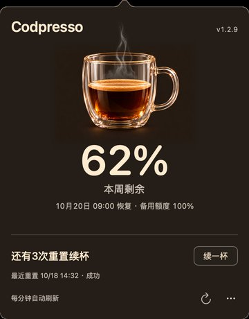

# Codpresso

一个原生 macOS 菜单栏小工具，用一杯咖啡显示 Codex 剩余额度。名字来自 Codex + espresso（意式浓缩咖啡）。

当前版本 **1.2.9 / build 15**，应用约 **1.18 MB**，ZIP 约 **831 KB**。[版本记录](CHANGELOG.md)



*截图使用离线演示数据，百分比和续杯次数不代表真实账户。*

## 功能

- 菜单栏显示剩余百分比；点击展开卡片，再次点击收起。
- 咖啡液面采用 13 档，热气随咖啡量变化；数字保留实际剩余整数。
- 显示用量周期、恢复时间、备用额度和可用重置次数；多周期时以核心额度中最低余额为主指标。
- 每分钟、电脑唤醒和展开卡片时刷新；读取失败时保留旧数据并提示。
- “续一杯”经过账户核验和二次确认；取消为默认操作，取消不会消耗次数。
- 按账户保存本工具发起的最近一次重置结果；结果未知时使用相同操作标识重试，避免重复消耗。

## 运行要求

- macOS 13 或更新版本。
- 已安装并登录 Codex CLI。
- 当前已在 Apple Silicon、macOS 27、Swift 6.4、Codex CLI 0.155.1 验证；尚未完成 Intel 或旧版 macOS 实机验证。

应用仅出现在菜单栏，不占 Dock。启动后卡片默认收起；再次打开已运行的应用会展开卡片。

## 从源码构建

需要 Swift 6 或更新工具链、macOS SDK、Python 3 和系统签名工具，无第三方 Swift 依赖；本机使用 Command Line Tools 构建。

克隆本仓库后，在项目根目录构建：

```sh
bash scripts/test.sh
bash scripts/build.sh
bash scripts/launch.sh
```

生成的应用位于 `dist/Codpresso.app`，可拖到“应用程序”目录。从旧版升级时，先退出旧应用，再安装并打开 `Codpresso.app`；不要同时保留旧应用为启动项。需要开机启动时，可在 macOS“系统设置 → 通用 → 登录项”添加应用。

构建采用本机 ad-hoc 签名，未做 Developer ID 公证。源码仓库不包含构建产物，`dist/` 中的安装包应作为 Release 附件单独分发。

## Codex CLI 与本地数据

CLI 从 `~/.local/bin/codex`、Codex standalone 安装目录、Homebrew 常用目录及 `PATH` 自动发现，也可在启动进程前设置 `CODEX_CLI_PATH`。Finder 启动不继承终端环境，因此优先使用默认安装位置。

应用通过本机 `codex app-server --stdio` 查询用量和提交经确认的重置，不直接读取或复制登录 token，不使用 API key。查询本身不会消耗重置次数。

重置记录保存在：

```text
~/Library/Application Support/CodexQuota/reset-history.json
```

改名沿用原有应用标识与上述记录目录，已有操作记录无需迁移。

记录包含账户标识、操作 UUID、时间和结果，不包含登录凭据。目录权限为 `0700`，文件权限为 `0600`。记录损坏或无法持久化时禁用重置；账户核验失败时也不会提交。

实际是否符合重置条件由 Codex 服务决定。接口未提供账户标识的旧版 CLI 仍可查看用量，但无法续杯。

## 开发与验证

- [开发命令与界面检查](docs/DEVELOPMENT.md)
- [1.2.9 验证结果与边界](docs/VERIFICATION.md)
- [素材来源、压缩与重建](docs/ASSETS.md)
- [提交范围与本地文件说明](docs/REPOSITORY.md)
- [隐私与公开前检查](docs/PRIVACY.md)

单元测试、离线界面与取消流程检查均不执行真实续杯。启动回归会退出当前应用并重新启动待测版本，只进行正常的用量读取。
